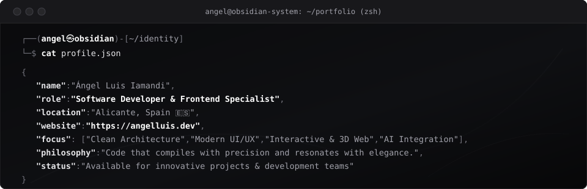

<!-- OBSIDIAN MARBLE DUAL-MODE BANNER -->
<a href="https://angelluis.dev"><picture><source media="(prefers-color-scheme: dark)" srcset="assets/banner-dark.svg"><source media="(prefers-color-scheme: light)" srcset="assets/banner-light.svg"></picture></a>

 

<!-- TYPING ANIMATION (MONOCHROME & LUXURY SILVER) -->

 

<!-- PROFILE VIEWS -->

---

## ✦ `$ whoami`

  

---

## ✦ `$ cat tech-stack.yaml`

<table width="100%" border="1" cellpadding="14" bgcolor="#09090b" style="border-collapse: collapse; border: 1px solid #27272a;">
  <thead>
    <tr bgcolor="#121214">
      <th colspan="2" align="left" style="color: #e4e4e7; font-family: monospace; padding: 12px 18px; border-bottom: 1px solid #27272a;">
        <code>angel@obsidian:~$ cat tech-stack.yaml</code>
      </th>
    </tr>
  </thead>
  <tbody>
    <tr>
      <td width="50%" valign="top" style="border: 1px solid #27272a; color: #a1a1aa;">
        <code style="color: #ffffff; font-weight: bold;">├─ ✦ core_frontend:</code>  
          
        <code>TypeScript · JavaScript · React · Vite · Astro · Tailwind · Bootstrap · CSS3</code>
      </td>
      <td width="50%" valign="top" style="border: 1px solid #27272a; color: #a1a1aa;">
        <code style="color: #ffffff; font-weight: bold;">├─ ⚙ backend_runtime:</code>  
        
          
        <code>Node.js · Python · Flask · PHP · Java · Socket.io</code>
      </td>
    </tr>
    <tr>
      <td valign="top" style="border: 1px solid #27272a; color: #a1a1aa;">
        <code style="color: #ffffff; font-weight: bold;">├─ ◈ data_cloud:</code>  
        
        
          
        <code>PostgreSQL · MySQL · Neon.tech (Serverless) · phpMyAdmin</code>
      </td>
      <td valign="top" style="border: 1px solid #27272a; color: #a1a1aa;">
        <code style="color: #ffffff; font-weight: bold;">├─ ✦ 3d_graphics_ui:</code>  
        
        
        
          
        <code>Three.js · GSAP · Chart.js · HTML5 Canvas · Three-VRM</code>
      </td>
    </tr>
    <tr>
      <td valign="top" style="border: 1px solid #27272a; color: #a1a1aa;">
        <code style="color: #ffffff; font-weight: bold;">├─ ⌁ ai_and_llms:</code>  
        
        
        
          
        <code>Llama 3.1 · Qwen 2.5:3B (Local) · Piper TTS · Gemini CLI · Antigravity</code>
      </td>
      <td valign="top" style="border: 1px solid #27272a; color: #a1a1aa;">
        <code style="color: #ffffff; font-weight: bold;">├─ 🔍 search_optimization_seo_geo:</code>  
        
          
        <code>Technical SEO · Core Web Vitals · Schema/JSON-LD · GEO (Generative Engine Optimization)</code>
      </td>
    </tr>
    <tr>
      <td colspan="2" valign="top" style="border: 1px solid #27272a; color: #a1a1aa;">
        <code style="color: #ffffff; font-weight: bold;">╰─ ⚑ tooling_environment:</code>  
          
        <code>Git · GitHub · VS Code · Linux · Bash Environment</code>
      </td>
    </tr>
  </tbody>
  <tfoot>
    <tr bgcolor="#121214">
      <td colspan="2" style="color: #71717a; font-family: monospace; padding: 10px 18px; border-top: 1px solid #27272a;">
        <code>status: ready_for_production&nbsp;&nbsp;·&nbsp;&nbsp;architecture: clean&nbsp;&nbsp;·&nbsp;&nbsp;search: seo_and_geo_ready</code>
      </td>
    </tr>
  </tfoot>
</table>

---

## ✦ `$ ls -l --sort=relevance featured-projects/`

<table width="100%" border="1" cellpadding="10" bgcolor="#09090b" style="border-collapse: collapse; border: 1px solid #27272a;">
  <thead>
    <tr bgcolor="#121214">
      <th align="left" style="color: #ffffff; font-family: monospace;">Proyecto</th>
      <th align="left" style="color: #ffffff; font-family: monospace;">Descripción</th>
      <th align="left" style="color: #ffffff; font-family: monospace;">Tecnologías Clave</th>
      <th align="center" style="color: #ffffff; font-family: monospace;">Demo / Enlace</th>
    </tr>
  </thead>
  <tbody>
    <tr>
      <td style="border: 1px solid #27272a;"><strong style="color: #ffffff;">🏆 Mundial 2026</strong></td>
      <td style="border: 1px solid #27272a; color: #a1a1aa;">Portal de resultados y simulador interactivo de la Copa Mundial 2026 con bracket dinámico y comparativas en vivo.</td>
      <td style="border: 1px solid #27272a;"></td>
      <td align="center" style="border: 1px solid #27272a;"></td>
    </tr>
    <tr>
      <td style="border: 1px solid #27272a;"><strong style="color: #ffffff;">🤖 VTuber Python Live</strong></td>
      <td style="border: 1px solid #27272a; color: #a1a1aa;">App 3D en tiempo real (Three.js/VRM) con IA local, síntesis de voz neuronal (Piper TTS), OBS chroma key y editor de poses.</td>
      <td style="border: 1px solid #27272a;"></td>
      <td align="center" style="border: 1px solid #27272a;"></td>
    </tr>
    <tr>
      <td style="border: 1px solid #27272a;"><strong style="color: #ffffff;">📷 Fotografía Mónica</strong></td>
      <td style="border: 1px solid #27272a; color: #a1a1aa;">Portafolio web premium para fotografía con selector de acento dinámico, máscara interactiva GSAP y óptimo SEO.</td>
      <td style="border: 1px solid #27272a;"></td>
      <td align="center" style="border: 1px solid #27272a;"></td>
    </tr>
    <tr>
      <td style="border: 1px solid #27272a;"><strong style="color: #ffffff;">📍 JobTracker Geolocation</strong></td>
      <td style="border: 1px solid #27272a; color: #a1a1aa;">Plataforma avanzada para registro de ofertas de empleo con mapas, cálculo de rutas en tiempo real y preparación de entrevistas.</td>
      <td style="border: 1px solid #27272a;"></td>
      <td align="center" style="border: 1px solid #27272a;"></td>
    </tr>
    <tr>
      <td style="border: 1px solid #27272a;"><strong style="color: #ffffff;">🕵️ El Impostor</strong></td>
      <td style="border: 1px solid #27272a; color: #a1a1aa;">Juego de deducción social multijugador con soporte tanto para salas locales como partidas online en tiempo real.</td>
      <td style="border: 1px solid #27272a;"></td>
      <td align="center" style="border: 1px solid #27272a;"></td>
    </tr>
  </tbody>
</table>

---

## ✦ `$ signals --telemetry --all-namespaces`

  <picture>
    <source media="(prefers-color-scheme: dark)" srcset="assets/radar-skills-dark.svg?v=3">
    <source media="(prefers-color-scheme: light)" srcset="assets/radar-skills-light.svg?v=3">
    
  </picture>&nbsp;&nbsp;
  <picture>
    <source media="(prefers-color-scheme: dark)" srcset="assets/radar-langs-dark.svg?v=3">
    <source media="(prefers-color-scheme: light)" srcset="assets/radar-langs-light.svg?v=3">
    
  </picture>

<code>signals: frontend_engineering_radar · stack_telemetry_radar · status: nominal · environment: production</code>

---

## ✦ `$ connect --socials`

&nbsp;&nbsp;&nbsp;&nbsp;&nbsp;&nbsp;&nbsp;&nbsp;

 
 

  ✦ <i>"El buen código se compila con precisión técnica y se experimenta con elegancia visual."</i> ✦ 
  Desarrollado desde Elche / Alicante, España · <a href="https://angelluis.dev" style="color: #a1a1aa;">@AngelLuisIamandi</a>

